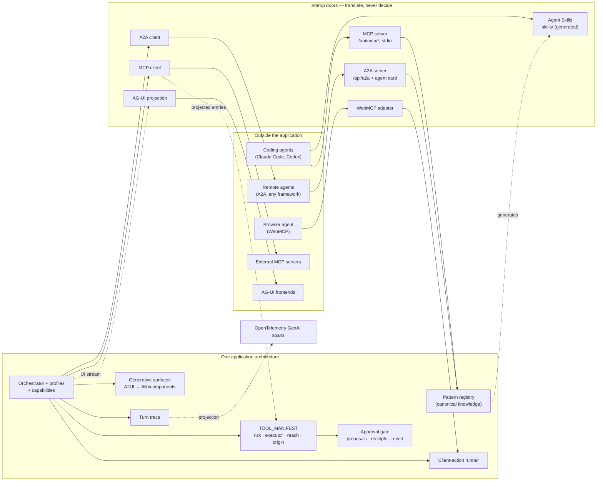

# Agentic architecture

How v10r takes part in the agentic ecosystem — reachable by agents, operable by agents,
collaborating with agents, and composing interfaces for people — without a second internal
architecture for each external standard. Researched, decided and partly built 2026-11-24
on branch `claude/cloud/agentic-architecture`; nothing here is shipped to `main`.

**The principle: one authoritative application architecture, many optional interoperability
adapters.** The tool catalogue (`TOOL_MANIFEST`), the one orchestrator, profiles and
capabilities, the approval gate with receipts and revert, the untrusted-content boundary and
the turn trace are the application. A protocol is a *door* onto them: it translates, it
never decides. An operation's risk is what it does, never which door it came through.

## Three properties, eleven domains

| Property | Means | The doors that provide it |
|---|---|---|
| **AI-accessible** | An outside agent can discover and use what the application knows and does | MCP server · A2A server · Agent Skills · WebMCP |
| **AI-interactive** | An agent and a person share one session: the agent sees state, acts on the interface, asks, waits for approval | Client actions · AG-UI · WebMCP · generative surfaces' actions |
| **AI-adaptive** | The interface itself is composed for the person's intent, from trusted parts | Generative surfaces (A2UI) · MCP Apps (provider) |

| Domain | Responsibility | v10r owner (existing) | Interop door (this initiative) | Decision |
|---|---|---|---|---|
| Model interoperability | Talking to models and providers | `ai/providers.ts`, AI SDK v6 | AI SDK v7 (prerequisite, separate branch — built on `claude/cloud/ai-sdk-v7`) | Adopt (built, branch) |
| Tool interoperability | Tools, resources, prompts | `TOOL_MANIFEST`, MCP server (`mcp-evolution/`) | **MCP client** on the official SDK | Adopt (built, wired to the deskbot through the external-operations door) |
| Agent interoperability | Delegation between independent agents | One orchestrator, capabilities | **A2A server + client** on the official JS SDK | Adapt (built) |
| Agent interaction | Agent ↔ frontend event stream | AI SDK UI message stream | **AG-UI projection** of that stream | Experiment (built) |
| Generative interfaces | Composing trusted native UI at run time | `#lib/components`, tokens | **A2UI v1.0** surfaces over `@a2ui/web_core` | Adapt (built, lazy) |
| Embedded applications | Shipping / hosting sandboxed apps | — | MCP Apps provider (experiment) / host (defer) | Defer |
| Agent-aware interfaces | Operating the existing UI semantically | Client actions (`agent-actions.md`) | **WebMCP** publication of the same contracts | Experiment (built) |
| Agent knowledge | Portable methodology | Pattern registry → docs, MCP | **Agent Skills** generated from the registry | Adopt (built) |
| Agent execution | Interactive and durable runs | Agent loop; proposals persist across requests | Workflow SDK / queues | Defer (no workload) |
| Agent observability | Traces, usage, evaluation | Turn trace, evals | **OpenTelemetry GenAI** projection of the trace | Adapt (built, no exporter) |
| Agent security | Identity, authorization, trust boundaries | Auth, scopes, approval gate, untrusted content | Same rules applied at every door; AGNTCY/ANP monitored | Adopt (rules) / Monitor |

## Topology

Read it as: every arrow into **Core** passes a door, and every door ends in something that
already existed. The two dotted edges into the catalogue and out of the trace are
projections — external tools become catalogue entries with a v10r-assigned risk; the trace
becomes spans without its bodies.

## Complementary, overlapping, competing

- **Complementary:** MCP (tools) · A2A (agents) · AG-UI (frontend events) · A2UI (UI payload)
  · Agent Skills (knowledge) · OpenTelemetry (telemetry). Each answers a different question;
  A2UI is explicitly transport-agnostic and can ride MCP, A2A or AG-UI.
- **Overlapping:** MCP Tasks ⟷ A2A tasks (both protocol-level task handles, neither is
  runtime durability); A2UI ⟷ MCP Apps (native declarative UI vs sandboxed HTML — a bridge
  exists, they solve different trust problems); WebMCP ⟷ client actions (same contract,
  different caller); AG-UI ⟷ the AI SDK UI stream (two wire formats over one agent loop —
  which is why AG-UI is a projection, not a replacement).
- **Competing:** A2UI ⟷ json-render ⟷ OpenUI as the generative-UI format (decided by
  measurement, [generative-ui.md](../../ai/generative-ui.md)); Workflow SDK ⟷ Temporal ⟷
  Inngest ⟷ Trigger.dev as durable runtimes (none adopted).

## Files

| File | Answers |
|---|---|
| [matrix.md](./matrix.md) | Every technology assessed: specification, versions, maturity (upstream vs SDK vs v10r), licence, governance, overlap, new capability, security, performance, dependency, cost, value, pattern, decision, evidence, reassessment trigger |
| [decision-record.md](./decision-record.md) | The decisions AA1–AA14, alternatives and what would reverse each |
| [plan.md](./plan.md) | The dependency-aware integration plan (waves A–E), what this branch built, the roadmap after it |
| [process.md](./process.md) | How the matrix stays current — the MCP evolution process, widened |
| [verification.md](./verification.md) | Local review and verification: startup, env, DB prep, `scripts/agentic/verify.sh` tiers, the manual steps with expected results, what stays unverified |
| [security.md](./security.md) | The trust model across every door: risk by effect, claims vs evidence, the threat list and where each threat is held |
| [../mcp-evolution/](../mcp-evolution/) | Tool interoperability's own deeper record (server side), unchanged and still authoritative for MCP server decisions |

Pattern documents for what was built: [generative-ui.md](../../ai/generative-ui.md),
[agent-to-agent.md](../../ai/agent-to-agent.md), [mcp-client.md](../../ai/mcp-client.md),
[agent-skills.md](../../ai/agent-skills.md), [webmcp.md](../../ai/webmcp.md),
[agent-user-interaction.md](../../ai/agent-user-interaction.md),
[agent-observability.md](../../ai/agent-observability.md). The integrated demonstration is
the **Agentic Interoperability Lab** at `/showcases/interop`.
