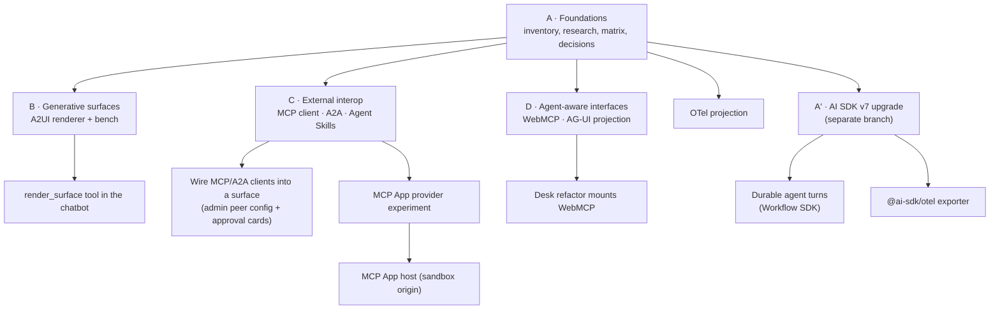

# Agentic architecture — integration plan and roadmap

Dependency-aware order of work. "Built" items are on branch
`claude/cloud/agentic-architecture` (not shipped). Every wave keeps the existing gates
(`validate`, `validate:build`, the perf ratchets) green and adds its own tests.

## Dependencies

## Waves

| Wave | Item | State | Depends on |
|---|---|---|---|
| A | Repository inventory, research of 15 areas, matrix, decisions AA1–AA14 | Done | — |
| A′ | AI SDK 6 → 7 (`ai`, `@ai-sdk/svelte@5`, providers @4), trace `usage` audit, middleware V4 | Built, merged — live turn per provider still owed ([../../ai/ai-sdk-v7.md](../../ai/ai-sdk-v7.md)) | A |
| B | A2UI v1.0 catalog, validator, lazy Svelte renderer, fixtures, token/bundle bench | Built | A |
| B | `render_surface` tool on the chatbot (catalog prompt, Express compile, surface actions → turn), 18-component catalog, event dedup, multi-turn eval cases | Built — live eval owed | B, live provider for evaluation |
| C | MCP client domain on the official SDK (guard, projection, drift, budgets) + Python FastMCP interop | Built | A |
| C | External operations: persistent claim, disclosure authorization, `/admin/ai/peers`, approval card, deskbot wiring for MCP peers and A2A delegation ([../../ai/external-operations.md](../../ai/external-operations.md)) | Built (Phase III) — live peer through the UI owed | C |
| C | A2A server (architecture review agent) + client + JS↔Python interop | Built | A |
| C | Agent Skills generated from the registry, gated | Built | A |
| C | MCP skills extension (`skills/list`) on the hosted server | Deferred until SDK support | C |
| D | WebMCP adapter over client actions; used by the Lab | Built (experiment) | A |
| D | AG-UI projection + official schema conformance; authenticated endpoint `POST /api/ai/ag-ui/deskbot` verified with the official `HttpAgent` | Built (experiment) | A |
| D | WebMCP on the refactored Desk | Planned | Desk refactor |
| E | OTel GenAI projection, cross-protocol correlation ids, Lab scenario | Built | A |
| E | OTel exporter via `instrumentation.server.ts` | Planned (operator choice) | A′ optional |
| E | MCP App provider: the pattern dependency explorer as a `ui://` View with text + `structuredContent` fallback ([mcp-apps.md](../../ai/mcp-apps.md)) | Built, merged · Experiment | — (B1 stays off; compat kit `_meta.ui` case passed in the cloud run, host runs owed) |
| E | MCP App host (requirements in [mcp-apps.md](../../ai/mcp-apps.md#mcp-apps-host-requirements-deferred)) | Deferred | sandbox origin |
| E | Durable agent execution | Deferred | A′ + a workload |
| E | ACP hand-off from Studio | Deferred | remote transport |
| E | Discovery / identity (AGNTCY, ANP, registries) | Monitor | partner requirement |

## Roadmap after this branch

1. **AI SDK v7** on `claude/cloud/ai-sdk-v7` — its own validate + build + a recorded live turn.
2. **Chatbot generative surfaces** — `render_surface` as a catalogue tool (`risk: view`), a
   live eval of Express validity across the three providers.
3. **One external MCP peer** chosen by ApeDevil — the admin page, approval card and persistent
   claim are built; what is left is the peer and a recorded run ([verification.md](./verification.md)).
4. **MCP App provider** — built as the pattern explorer; next: a recorded run in an external host
   (Claude, ChatGPT or VS Code).
5. **Durable runs** only when (1) is done and a run must outlive a request.
