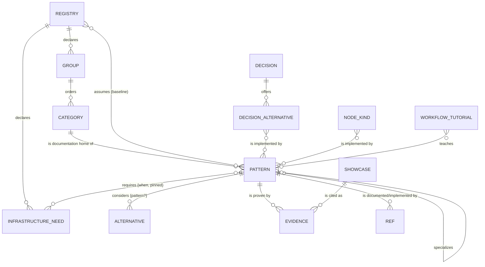

# C. Proposed target ontology

**Recommendation in one sentence:** keep the version-controlled registry as the only authority and turn it
into a *typed relationship graph* — three typed pattern relationships, a small closed `kind`, capability-level
infrastructure needs, evidence-derived maturity and one declared platform baseline — validated by the same
gate and served by the same query layer. No database projection, no graph database, no ontology framework.

Everything below is a proposal for review. Nothing has been applied.

## C.1 Comparison of architectural directions

| Criterion | A. Refine the current model | **B. Typed graph in the registry** (recommended) | C. Extensive ontology + DB projections |
|---|---|---|---|
| What changes | fill `requires` on light rows, fix titles, fix plan bugs; keep one `depends_on` | A + typed relationships, `kind`, capability needs with bindings, derived evidence, baseline, one graph module | B + independent Capability, Technology, Evidence, Decision entities as their own files; Postgres tables and a Neo4j projection of the graph |
| Semantic clarity | low: composition/optional/specialization stay implicit (F01) | high: every edge has one meaning | high, but meaning spread over many entity files |
| Human understandability | unchanged | composition tree + dependency DAG become visible | richest, most to learn |
| AI understandability | better needs; plans still over-adopt (F04) | plans can separate required/optional and say why | same as B for the questions agents ask |
| Implementation complexity | small (≈1 slice) | medium (≈6 slices, mostly data curation) | large (B + schema, sync jobs, projections) |
| Maintainability | authors still choose one edge for five meanings | one decision per edge, gated | multiple files per concept, sync to keep honest |
| Extensibility | poor | new relationship = schema + gate change | best on paper |
| Query efficiency | in-memory, µs | in-memory, µs (≈200 nodes, ≈250 edges) | DB round trips for what memory answers today |
| Token efficiency | unchanged | better: fewer wrong steps (F04 shows 6–7 extra steps per plan) | same as B |
| Validation | as today | stronger: typed cycles, contradictions, needs evidence | needs registry↔DB consistency gates on top |
| Offline (stdio, read-only container) | yes | yes | only if the projection is optional |
| Infrastructure | none | none | Postgres tables and Neo4j for data that fits in one JSON file |
| Knowledge duplication risk | low | low | high: two stores for one fact |
| Long-term coherence | debt remains | good | good if the sync never drifts |

**Why B.** The failures found (F01–F05, F07) are semantic, not scale problems: the registry lacks *types*, not
storage. B fixes every reproduced failure with the smallest change and keeps the properties that make the
registry valuable: deterministic, offline, reviewable diffs, provenance in git. C's extra entities would add
value only for questions nobody asks yet (no consumer needs joins between tenant data and the pattern graph;
Neo4j holds no pattern data today and nothing reads one). C stays a documented revisit path (D-02).

From C, B adopts only two concepts that already exist in code and need no new store: the **capability-level
infrastructure vocabulary** (a list with bindings in `schema.ts`) and **one evidence-kind vocabulary** shared
with Architecture Engineering.

## C.2 Canonical conceptual model



### Concepts

| Concept | Definition | Identity | Authority |
|---|---|---|---|
| **Pattern** | Reusable engineering knowledge: a recurring problem in a context, a solution, and the invariants that make it work. | kebab id naming the concept (not its location) | `registry.json` |
| Pattern **kind** | `pattern` (a solution to build), `principle` (a rule or review lens applied to other work; never a plan step), `workflow` (a procedure people or agents perform with tools). | closed enum | `schema.ts` |
| **Tier** | Documentation depth only: `deep` = emulation card (invariants, emulation notes), `light` = index record. Never decides selection, needs or relationships. | closed enum | `schema.ts` |
| **Category / group** | The pattern's single documentation home and navigation section. Not a semantic type. | kebab id | `registry.json` |
| **Relationship** | A typed, directed, authored edge between two patterns (C.3). Inverses are derived, never authored. | (type, from, to) | `registry.json` |
| **Platform baseline** | Patterns every record assumes the target already follows (proposed: `multi-client-core`; D-05). Printed once per plan; never an edge. | list of ids | registry root `assumes` |
| **Infrastructure need** | A capability the target must run (relational database, key-value store, …), with v10r's binding as data. | closed id | `schema.ts` `INFRASTRUCTURE` |
| **Alternative** | A considered different approach and when it wins; optionally a registry pattern id. | position in the record | record |
| **Evidence** | A typed ref proving the pattern: `unit-test`, `db-test`, `browser-test`, `measurement`, `showcase`, `app-route`, `live-check`. | (kind, path) | record |
| **Maturity** | **Derived** from evidence (C.5), never hand-set. | closed enum | computed in `schema.ts` |
| **Capability** | What a pattern enables, as discovery vocabulary. Stays free text until measurement justifies control (D-07). | — | record `capabilities` |
| **Decision** (AE) | A workload-level architectural question with alternatives and rules; references patterns, never copies them. | id + revision | `decisions.json` |
| **Showcase** | A live demo route; cited as evidence, back-linked from the registry. | href | showcase catalog |

## C.3 Relationships

Three authored pattern-to-pattern relationships replace `depends_on`. Each was tested against all 88 current
edges ([edge-classification.md](./edge-classification.md)); each changes what a plan does.

| | `builds_on` | `composes` | `specializes` |
|---|---|---|---|
| Meaning | A cannot work unless B (or the target's equivalent of B) is present. | B is a constituent of A's solution: adopting A means building B as part of it. | A is a narrower realization of B; B's invariants hold in A. |
| Test question | Could the target satisfy B with something it already has? → yes | Is B described inside A's solution? → yes | Is every A a B? → yes |
| Direction / inverse | A → B / *built on by* | A → B / *part of* | A → B / *specialized by* |
| Cardinality | 0..n | 0..n; entry `{id, optional?, when?}` | **0..1** (single parent keeps inheritance unambiguous) |
| Symmetric / transitive | no / yes (prerequisite closure) | no / yes (nested composition) | no / yes |
| Cycles | forbidden over the **union** of the three types | | |
| Conditionality | none (unconditional by definition) | `optional: true` requires a `when` sentence | none |
| Plan consequence | included, ordered before A, labelled "required by A" | required constituents included; optional ones listed with their `when`, included only on request | B's invariants listed as inherited; B not a separate step unless also required |
| Needs propagation | B's needs are A's needs | required: yes; optional: reported as conditional | yes |
| Authored or derived | authored | authored | authored |
| Current edges (of 88) | 29 | 26 + 8 optional | 4 |

**Considered and rejected**

| Candidate | Verdict | Reason |
|---|---|---|
| `extends` | merged into `builds_on` | An extension needs its host present; the plan consequence is identical (desk panels, `form-draft-recovery`). |
| `alternative_to` | not an edge; `alternatives[].pattern` optional id | Alternatives are already authored per record with `prefer_when`; an id makes them navigable without a second symmetric relation to keep consistent. The inverse ("considered by") is derived. |
| `complements` | rejected | Generic and unactionable: 12 current edges of this sort lead to wrong plan steps. When B really belongs with A it is an optional constituent. |
| `conflicts_with` | deferred | No genuine incompatibility found in 199 records; target-condition conflicts are already `avoid_when`. Revisit when a real case appears. |
| `conforms_to` principle | replaced by the baseline + `kind: principle` | 9 edges to `multi-client-core`/`ui-component-system` are assumptions, not steps. |
| `verifies` / `references` | not relationships | Evidence and rationale are refs (`evidence[]`, AE decisions), not pattern edges. |

### Constraints and semantic invariants (all deterministic)

1. Every relationship target exists, is not the source, and appears at most once per source across all three types (no pair is both `builds_on` and `composes`).
2. The union of `builds_on ∪ composes ∪ specializes` is acyclic.
3. `specializes` has at most one target, of the same `kind`.
4. `principle` records are never `builds_on`/`composes` targets (they are conformance, not steps); `workflow` records may compose patterns.
5. `composes {optional: true}` carries a non-empty `when`.
6. `alternatives[].pattern`, when present, resolves and is not also a `builds_on`/`composes` target of the same record (a thing cannot be both the chosen part and the rejected option).
7. A baseline pattern is never an explicit relationship target.
8. Needs: a record's declared needs ∪ inherited needs must cover the needs the import-scan finds in its code refs (C.4), unless an allow-listed exception gives a reason.

## C.4 Infrastructure needs

One closed list of **capabilities**, each with v10r's binding as data, replacing the mixed `PATTERN_REQUIREMENTS`:

| Need (proposed id) | Replaces | v10r binding | Evidence the import-scan looks for |
|---|---|---|---|
| `relational-db` | `postgres` | PostgreSQL (Neon) via Drizzle | `#lib/server/db` |
| `vector-search` | `pgvector` | pgvector (needs `relational-db`) | `vector(` columns, retrieval tiers |
| `graph-db` | `neo4j` | Neo4j Aura (HTTP Query API) | `#lib/server/graph` |
| `key-value-store` | `redis` | Redis (Upstash, REST) | `#lib/server/cache`, `@upstash/*` |
| `object-storage` | `object-storage` | Cloudflare R2 (S3 API) | `@aws-sdk/client-s3`, `#lib/server/storage` |
| `scheduler` | `cron` | Vercel cron / container interval | `vercel.json` crons, jobs registry |
| `llm-provider` | `ai-provider` | AI SDK providers | `#lib/server/ai/providers` |
| `email-delivery` | part of `third-party-api` | Resend | email sender module |
| `external-api` | `third-party-api` | per pattern | fetch through `http/peer-egress` |
| `web-worker`, `service-worker`, `wasm-toolchain`, `container-host` | same | same | worker/`?url` imports, SW file, crate build |

Entry forms in a record: `"relational-db"`, or `{ "need": "relational-db", "pinned": "postgres", "why": "FOR UPDATE SKIP LOCKED claims" }`
when the technology is not replaceable, or `{ "need": "key-value-store", "when": "serverless (no persistent process)" }`
for conditional needs. `target_infra` accepts a need id or a binding; a pinned need only fits the pinned technology.

## C.5 Evidence and maturity

```text
evidence: [ { kind: unit-test | db-test | browser-test | measurement | showcase | app-route | live-check,
              path, claim?, required?: true (live-check), checkedAt?: YYYY-MM-DD (live-check only) } ]

maturity (derived):
  proven        ⇔ ≥1 unit-test/db-test the gate actually runs   ∧ no required live-check pending
  demonstrated  ⇔ only showcase / app-route / browser-test / measurement evidence
  implemented   ⇔ code refs, no evidence — or a required live-check pending (e.g. MCP 3D in a real host)
  planned       ⇔ no code refs
```

`verifiedSha` is dropped (20 of 23 values no longer resolve after history rewrites); passing tests on HEAD are
the freshness. `checkedAt` survives only on `live-check` evidence, which no gate can re-run. The evidence-kind
words are shared with Architecture Engineering's `EVIDENCE_KINDS` (one vocabulary, D-08). This is the
`evidence-status-dimensions` pattern applied to the registry itself.

Measured consequence on today's data (reviewer's mapping, to be confirmed in Slice 4): of 173 `proven`,
76 have a test ref and would stay proven; ~97 light records proven by a route alone would read `demonstrated`.

## C.6 Pattern anatomy

| Field | Mandatory for | Notes |
|---|---|---|
| `id`, `kind`, `title`, `category`, `summary`, `when_to_use`, `risk {level, reason}` | all | `title` = canonical name only (no counts, no parenthetical summary) |
| `requires`, `builds_on`, `composes`, `specializes` | all (may be empty) | **structural facts are never optional by tier** |
| `docs` ≥ 1 | all | |
| `code`, `evidence` | all (may be empty) | maturity derived from them |
| `capabilities`, `keywords` | all | discovery only |
| `avoid_when` ≥ 1, `alternatives` ≥ 1 | deep | encouraged on light |
| `invariants` ≥ 1, `emulation_notes` ≥ 1 | deep | forbidden on light (unchanged) |
| inverse relations, transitive needs, inherited invariants, maturity | — | **derived**, never authored |

Removed or replaced: `depends_on` (→ typed relationships), `tests`/`showcases` (→ `evidence`), `maturity`,
`verifiedAt`, `verifiedSha` (→ derived), free-text `risk` (→ `{level, reason}`).

## C.7 Recursive composition — worked examples

**MCP 3D (`agentic-parametric-modeling`)**, today a flat list of 6 mandatory `depends_on`:

```text
agentic-parametric-modeling                      needs: relational-db, key-value-store, email-delivery (inherited)
├─ specializes  asset-production-pipeline        (its invariants hold: one request schema, same bytes, inspection)
│   ├─ composes derivation-key                   needs: relational-db
│   ├─ composes provenance-record → composes derivation-key   (shared constituent, one record)
│   ├─ composes anti-abuse-rate-limiting         needs: key-value-store
│   ├─ composes? architecture-hosted-mcp         when: agents call the pipeline over MCP
│   └─ composes? 3d-threlte-integration          when: the app shows the asset in a native viewer
├─ composes architecture-mcp-authorization
│   ├─ builds_on identity-passwordless-auth      (replaceable: any user-account auth)  needs: relational-db, email-delivery
│   ├─ builds_on architecture-hosted-mcp
│   └─ composes anti-abuse-rate-limiting         (shared again — not duplicated)
├─ builds_on architecture-hosted-mcp
├─ composes? ai-mcp-app-provider                 when: the host supports MCP Apps
└─ composes? 3d-threlte-integration              when: the native viewer is wanted   needs: web-worker
```

Today's plan: 10 mandatory steps, needs `postgres, web-worker`. Proposed plan: 8 required steps, 2 optional
constituents with their condition, needs `relational-db, key-value-store, email-delivery` and `web-worker`
(conditional).

**Grounded retrieval (`layered-rag`)**: `composes retrieval-endpoints`, `composes? ai-graph-rag (when multi-hop
relationship questions matter; needs graph-db)`. Today the graph tier is a disconnected sibling and `graph-db`
never reaches the plan.

**Rate limiting** becomes reachable: a light record may be a plan step, and its `key-value-store` need is
declared; the MCP authorization plan inherits it.

**Hosted MCP**: `composes anti-abuse-rate-limiting`, needs `relational-db, key-value-store`; the "no infrastructure"
answer disappears.

**Architecture Engineering**: no relationships; the decision catalogue already links patterns, and the derived
view "referenced by decision X" replaces the four `depends_on` edges that made plans add a Rust service.

### Traversal and presentation limits

- Composition depth in today's data is ≤ 3 (MCP 3D). Cards print direct relations plus counts; explorers expand on demand.
- Shared constituents render once per tree with "also part of …" (no duplicated records, no duplicated subtrees).
- Plans dedupe by id and order by the union graph (Kahn, ties by registry order — unchanged).
- Bounds stay as today (≤ 5 cards, plans outlined above 32k chars); the "why included" chain names one path, not all.

## C.8 Vocabulary (additions to `docs/naming.md`)

| Canonical term | Concept | Retire / avoid |
|---|---|---|
| **pattern** | the registry concept | "record/entry/card" for the concept (keep "card" only for the rendered `get_pattern` answer) |
| **pattern record** | one entry in `registry.json` | "registry entry", "index row" (use "light record") |
| **deep record / light record** | tier values | "deep card / index card / index row / emulation card" |
| **builds on / built on by** | prerequisite relation | `depends_on`, "depended by", "dependency" for pattern edges (naming.md keeps dependency = infrastructure service) |
| **composes / part of**, **optional constituent** | composition | "nested pattern", "sub-pattern" |
| **specializes / specialized by** | specialization | "extends", "variant" |
| **infrastructure need** (`requires`) | what the target must run | "requirement" (retired for workload profiles), "dependency" |
| **platform baseline** (`assumes`) | what every pattern assumes | — |
| **evidence**, **maturity** (derived) | proof | `showcases[]` for non-showcase proof |
| **pattern capability** | what a pattern enables | add as the fourth subject of "capability" in naming.md |

## C.9 Ownership, authority and derivation

| Knowledge | Authority (one) | Derived representations (generated, gated) |
|---|---|---|
| Pattern records, relationships, needs, evidence | `pattern-library/registry.json` + `schema.ts` | docs pages, README index, Agent Skills, MCP excerpt snapshot, explorer projection, `/showcases/mcp` graph, retrieval chunks of the pages |
| Inverses, closures, inherited invariants, maturity | `pattern-library/pattern-graph.ts` (new, framework-free) | every tool, page and view |
| Infrastructure vocabulary + bindings | `schema.ts` `INFRASTRUCTURE` | `target_infra` enum, AE node-kind needs (checked) |
| Workload decisions | `decisions.json` | Studio, `explore_architecture` |
| Showcase list | showcase catalog | registry evidence refs (checked), back-links (derived) |
| Registry content identity | computed digest | tool responses, bench results, ingest derivation key |
