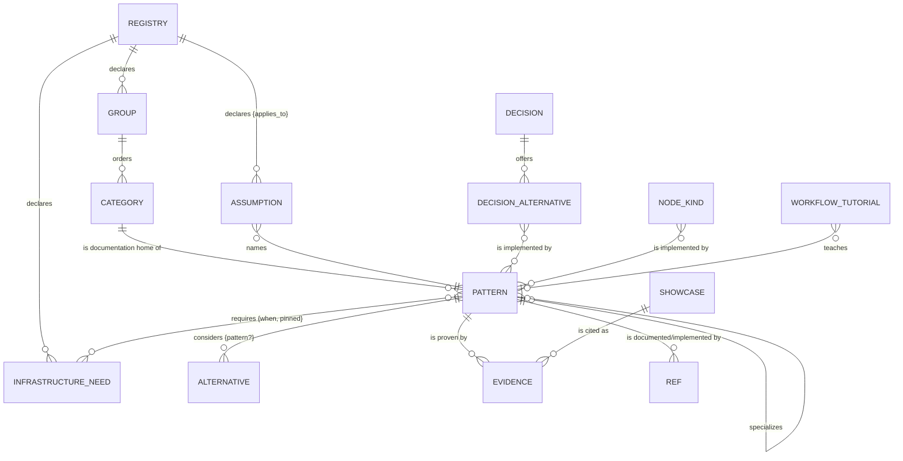

# C. Proposed target ontology

**Recommendation in one sentence:** keep the version-controlled registry as the only authority and turn it
into a *typed relationship graph* — three typed pattern relationships, a small closed `kind`, capability-level
infrastructure needs, evidence-derived maturity and scoped platform assumptions — validated by the same
gate and served by the same query layer. No database projection, no graph database, no ontology framework.

Status: **accepted with adjustments** (2026-11-28, [decision register](./decision-register.md)). The adjustments
are folded into the sections below; §C.4 (infrastructure needs) is implemented in Slice 1, see
[slice-1.md](./slice-1.md); entity kinds (§C.2) and the record reconciliation in Slice 2, see
[slice-2.md](./slice-2.md). Everything else is the agreed target, applied slice by slice.

## C.1 Comparison of architectural directions

| Criterion | A. Refine the current model | **B. Typed graph in the registry** (recommended) | C. Extensive ontology + DB projections |
|---|---|---|---|
| What changes | fill `requires` on light rows, fix titles, fix plan bugs; keep one `depends_on` | A + typed relationships, `kind`, capability needs with bindings, derived evidence, scoped assumptions, one graph module | B + independent Capability, Technology, Evidence, Decision entities as their own files; Postgres tables and a Neo4j projection of the graph |
| Semantic clarity | low: composition/optional/specialization stay implicit (F01) | high: every edge has one meaning | high, but meaning spread over many entity files |
| Human understandability | unchanged | composition tree + dependency DAG become visible | richest, most to learn |
| AI understandability | better needs; plans still over-adopt (F04) | plans can separate required/optional and say why | same as B for the questions agents ask |
| Implementation complexity | small (≈1 slice) | medium (≈6 slices, mostly data curation) | large (B + schema, sync jobs, projections) |
| Maintainability | authors still choose one edge for five meanings | one decision per edge, gated | multiple files per concept, sync to keep honest |
| Extensibility | poor | new relationship = schema + gate change | best on paper |
| Query efficiency | in-memory, µs | in-memory, µs (≈200 nodes, ≈250 edges) | DB round trips for what memory answers today |
| Token efficiency | unchanged | better: fewer wrong steps (F04 shows 6–7 extra steps per plan) | same as B |
| Validation | as today | stronger: typed cycles, contradictions, needs evidence | needs registry↔DB consistency gates on top |
| Offline (stdio, read-only container) | yes | yes | only if the projection is optional |
| Infrastructure | none | none | Postgres tables and Neo4j for data that fits in one JSON file |
| Knowledge duplication risk | low | low | high: two stores for one fact |
| Long-term coherence | debt remains | good | good if the sync never drifts |

**Why B.** The failures found (F01–F05, F07) are semantic, not scale problems: the registry lacks *types*, not
storage. B fixes every reproduced failure with the smallest change and keeps the properties that make the
registry valuable: deterministic, offline, reviewable diffs, provenance in git. C's extra entities would add
value only for questions nobody asks yet (no consumer needs joins between tenant data and the pattern graph;
Neo4j holds no pattern data today and nothing reads one). C stays a documented revisit path (D-02).

From C, B adopts only two concepts that already exist in code and need no new store: the **capability-level
infrastructure vocabulary** (a list with bindings in `schema.ts`) and **one evidence-kind vocabulary** shared
with Architecture Engineering.

## C.2 Canonical conceptual model



### Concepts

| Concept | Definition | Identity | Authority |
|---|---|---|---|
| **Pattern** | Reusable engineering knowledge: a recurring problem in a context, a solution, and the invariants that make it work. | kebab id naming the concept (not its location) | `registry.json` |
| Pattern **kind** | `pattern` (a solution to build), `principle` (a rule or review lens applied to other work; never a plan step), `workflow` (a procedure people or agents perform with tools). | closed enum | `schema.ts` |
| **Tier** | Documentation depth only: `deep` = emulation card (invariants, emulation notes), `light` = index record. Never decides selection, needs or relationships. | closed enum | `schema.ts` |
| **Category / group** | The pattern's single documentation home and navigation section. Not a semantic type. | kebab id | `registry.json` |
| **Relationship** | A typed, directed, authored edge between two patterns (C.3). Inverses are derived, never authored. | (type, from, to) | `registry.json` |
| **Platform assumption** | A pattern that records in a declared scope assume the target already follows (e.g. `multi-client-core` for server-side records). Printed once per plan only when a selected step is in scope; never an edge, never unconditional (D-05, §C.3.4). | `{id, applies_to}` | registry root `assumptions` |
| **Infrastructure need** | A capability the target must run (relational database, key-value store, …) at a level (required, conditional, optional, implementation), with v10r's binding as data. | closed id | `schema.ts` `INFRASTRUCTURE_NEEDS` |
| **Alternative** | A considered different approach and when it wins; optionally a registry pattern id. | position in the record | record |
| **Evidence** | A typed ref proving the pattern: `unit-test`, `db-test`, `browser-test`, `measurement`, `showcase`, `app-route`, `live-check`. | (kind, path) | record |
| **Maturity** | **Derived** from evidence (C.5), never hand-set. | closed enum | computed in `schema.ts` |
| **Capability** | What a pattern enables, as discovery vocabulary. Stays free text until measurement justifies control (D-07). | — | record `capabilities` |
| **Decision** (AE) | A workload-level architectural question with alternatives and rules; references patterns, never copies them. | id + revision | `decisions.json` |
| **Showcase** | A live demo route; cited as evidence, back-linked from the registry. | href | showcase catalog |

### Entity kinds and their adoption semantics

`kind` answers one question: **what does adopting this record mean?** It is the only classification the planner
reads; tier, category and group never change what a plan does (D-11). No further kinds without a case where a
tool would behave differently (D-03).

| Kind | What it is | What adopting it means | In a plan | May be the target of | May have |
|---|---|---|---|---|---|
| `pattern` | A reusable solution to build: problem, context, solution, invariants. | Build it (or map it onto something the target already has, for a `builds_on` target). | A step, with a traceable reason. | `builds_on`, `composes`, `specializes` (from a pattern) | every relationship, needs, evidence |
| `principle` | A rule or review lens applied to other work (e.g. explosive discovery, component-first). Nothing to build by itself. | Conform to it: review the work against its rules. | Never a step. Listed once under "Applies" when a selected step conforms to it, with the reason. | `specializes` (from a principle) only; referenced by patterns, never built on or composed | evidence of conformance checks, no infrastructure needs |
| `workflow` | A procedure people or agents perform with tools (e.g. a schema push workflow, a sheet transform recipe). | Follow it: the procedure is the deliverable; the patterns it uses are adopted as its constituents. | A step when asked for; its composed patterns are steps in their own right. | `composes` (from a workflow), `specializes` (from a workflow) | `composes` patterns, needs of the tools it runs |

Rules: a pattern never `builds_on` or `composes` a principle or a workflow; a workflow may compose patterns; a
`specializes` edge stays inside one kind.

## C.3 Relationships

Three authored pattern-to-pattern relationships replace `depends_on`. Each was tested against all 88 current
edges ([edge-classification.md](./edge-classification.md)), and each changes what a plan does. The vocabulary
stays at three until a concrete case needs a fourth (approval §4). One planning-neutral list for
non-dependency links is proposed separately (§C.3.3, D-15).

### C.3.1 Semantics of each relationship

| Property | `builds_on` | `composes` | `specializes` |
|---|---|---|---|
| Meaning | A cannot work unless B, or the target's own equivalent of B, is present. | B is a constituent of A's solution: adopting A means building B as part of it. | A is a narrower realization of B: every A is a B, and B's invariants hold in A. |
| Test question | Could the target satisfy B with something it already has? → yes | Is B described inside A's solution? → yes | Is every A a B? → yes |
| Direction | A → B (A is the dependent) | A → B (A is the whole) | A → B (A is the narrower) |
| Inverse (derived, never authored) | B *is built on by* A | B *is part of* A | B *is specialized by* A |
| Cardinality | 0..n per A | 0..n per A; entry `{id, optional?, when?}` | 0..1 per A (one parent keeps inheritance unambiguous); 0..n specializations per B |
| Transitive | yes: the prerequisite closure | yes for required entries; **an optional edge ends the required chain**: everything reached only through an optional edge is optional with the same condition | yes for invariants (A inherits B's and B's parent's) |
| Symmetric | no | no | no |
| Conditionality | none: a prerequisite holds unconditionally, or it is not a prerequisite | `optional: true` requires a `when` sentence; required entries carry no condition | none |
| Cycles | forbidden over the **union** of the three types (one acyclic graph) | | |
| Same kind? | pattern → pattern | pattern → pattern; workflow → pattern | within one kind |
| Needs propagation | B's required and conditional needs become A's, labelled "via B" | required entry: as `builds_on`; optional entry: B's needs are reported as conditional on the entry's `when` | B's needs are A's (A is a B) |
| Plan consequence | B is a step ordered before A, reason "A builds on B"; replaceable by an equivalent the target already has | required B is a step, reason "part of A"; optional B is listed with its `when`, never a step unless the caller includes it | **B is not a second implementation step.** A's step lists B's invariants as inherited; B appears as a step only if something else requires B itself |

### C.3.2 Planning rules (deterministic, apply to every consumer)

1. **Traceable reason.** Every step carries one reason chain back to the request: `requested (capability "…")`,
   `requested (id)`, `A builds on B`, `part of A`, `part of A, included because condition satisfied`. The chain
   names one path; the step lists the number of other paths.
2. **Shared constituents are deduplicated.** A constituent reached through several parents is one step, with
   "also part of …" listing the other parents. Its needs are counted once.
3. **Optional never turns required by traversal.** Required-ness is computed per path: a node is required only
   if some path from a requested record to it consists of required edges only.
4. **Conditions are three-valued.** Each optional entry's condition is *satisfied* (the caller included it),
   *unsatisfied* (the caller excluded it) or *unknown* (default). Unknown conditions are listed as open
   decisions with their `when` sentence; they are never adopted silently and never dropped silently.
   Conditional needs follow the same three values.
5. **Unavailable and conflicting prerequisites are reported.** When a required step needs infrastructure the
   target lacks, the step is marked blocked with the need, the record's alternatives and the steps that build
   on it. When the caller excludes a record that something requested builds on, the plan names the conflict
   instead of producing a partial plan that looks complete.
6. **Inherited invariants apply to the selected implementation.** Invariants are inherited only along
   `specializes` (where the definition guarantees they hold). Invariants of a `builds_on` or `composes` target
   belong to that target's own step and are never copied onto the dependent. A specialization whose
   implementation cannot satisfy one of its parent's invariants is not a specialization; review reclassifies it.
7. **Principles are constraints, not steps.** Selected steps that conform to a principle list it once under
   "Applies"; a principle never adds a step or a need.
8. **Platform assumptions never add architecture silently** (§C.3.4).

### C.3.3 What is not a relationship, and where that knowledge goes

Removing a wrong edge must not erase knowledge. Each of today's non-dependency edges keeps its meaning in a
typed, checked place:

| Knowledge | Home | Checked by |
|---|---|---|
| "B is a considered alternative to A" | `alternatives[].pattern` (canonical id) next to `approach` and `prefer_when` | id resolves; not also a `builds_on`/`composes` target of A |
| "A conforms to principle P" | derived from P's scope or a principle reference, printed under "Applies" | P is `kind: principle` |
| "A is related to B, but neither needs the other" (12 of today's edges) | proposed `references: [{id, why}]`, never traversed by planning (D-15) | id resolves; `why` non-empty |
| "A is shown working in showcase S" | evidence (§C.5) | route registered |
| "decision X offers pattern A" | `decisions.json` (derived inverse on the card) | decision invariant 8 |

### C.3.4 Platform assumptions

The approval (D-05) rejects an unconditional baseline. Four kinds of "everything assumes this" are kept apart:

| Kind | Example | Where it lives | Plan consequence |
|---|---|---|---|
| Platform-wide convention | component-first UI, i18n message keys, the hooks pipeline order | `kind: principle` records with an explicit scope (e.g. "applies to records with UI code") | listed under "Applies" only when a selected step is in scope |
| Domain-specific assumption | server patterns assume a framework-free domain layer behind thin adapters (`multi-client-core`) | an assumption entry `{id, applies_to}` where `applies_to` is a closed selector (records whose code lives under `src/lib/server/`, a category list, or an explicit id list) | printed once per plan, only if a selected step matches the selector; never a step unless requested |
| Actual prerequisite | MCP authorization builds on hosted MCP | `builds_on` | step |
| Implementation-specific choice | v10r deploys to Vercel; uses Neon for Postgres | infrastructure binding or `implementation` need level (§C.4), deployment docs | shown as v10r's choice, never a requirement |

Gate: an assumption's selector must match at least one record, and the bench checks that a plan with no
matching step never mentions the assumption.

### Considered and rejected

| Candidate | Verdict | Reason |
|---|---|---|
| `extends` | merged into `builds_on` | An extension needs its host present; the plan consequence is identical (desk panels, `form-draft-recovery`). |
| `alternative_to` | not an edge; `alternatives[].pattern` optional id | Alternatives are already authored per record with `prefer_when`; an id makes them navigable without a second symmetric relation to keep consistent. The inverse ("considered by") is derived. |
| `complements` | rejected | Generic and unactionable: 12 current edges of this sort lead to wrong plan steps. Where B really belongs with A it is an optional constituent; otherwise a planning-neutral reference (D-15). |
| `conflicts_with` | deferred | No genuine incompatibility found in 199 records; target-condition conflicts are already `avoid_when`. Revisit when a real case appears. |
| `conforms_to` principle | replaced by scoped assumptions + `kind: principle` | 9 edges to `multi-client-core`/`ui-component-system` are assumptions, not steps. |
| `verifies` | not a relationship | Evidence is its own model (§C.5). |
| unconditional root `assumes` | rejected by D-05 | Would print architecture into plans that do not need it. Replaced by scoped assumptions (§C.3.4). |

### Constraints and semantic invariants (all deterministic)

1. Every relationship target exists, is not the source, and appears at most once per source across all three types (no pair is both `builds_on` and `composes`).
2. The union of `builds_on ∪ composes ∪ specializes` is acyclic.
3. `specializes` has at most one target, of the same `kind`.
4. `principle` records are never `builds_on`/`composes` targets (they are conformance, not steps); `workflow` records may compose patterns.
5. `composes {optional: true}` carries a non-empty `when`.
6. `alternatives[].pattern`, when present, resolves and is not also a `builds_on`/`composes` target of the same record (a thing cannot be both the chosen part and the rejected option).
7. A platform assumption is never an explicit relationship target, and its `applies_to` selector matches at least one record.
8. Needs: a record's declared needs ∪ inherited needs must cover the needs the import-scan finds in its code refs (C.4), unless an allow-listed exception gives a reason.

## C.4 Infrastructure needs

*Implemented in Slice 1* ([slice-1.md](./slice-1.md)). One closed list of **infrastructure needs**, named for
the capability, each with v10r's reference binding and the technologies known to provide it, replaces the
mixed `PATTERN_REQUIREMENTS`. Authority: `INFRASTRUCTURE_NEEDS` in `pattern-library/schema.ts`.

| Need | Replaces | v10r's reference binding | Technologies `target_infra` also accepts |
|---|---|---|---|
| `relational-db` | `postgres` | PostgreSQL (Neon) through Drizzle | `postgres`, `mysql`, `sqlite` |
| `vector-search` | `pgvector` | pgvector inside PostgreSQL | `pgvector` |
| `graph-db` | `neo4j` | Neo4j Aura over the HTTP Query API | `neo4j` |
| `key-value-store` | `redis` | Redis (Upstash, REST) | `redis` |
| `object-storage` | `object-storage` | Cloudflare R2 over the S3 API | `s3` |
| `scheduler` | `cron` | Vercel cron calling the jobs runner | `cron` |
| `llm-provider` | `ai-provider` | provider-agnostic AI SDK adapters | — |
| `email-delivery` | part of `third-party-api` | Resend | `resend` |
| `external-api` | `third-party-api` | per pattern (named in `why`/`when`) | — |
| `web-worker`, `service-worker`, `wasm-toolchain`, `container-host` | same | browser workers; Rust → wasm-pack; Podman / a container host | — |

### Levels: what a declared need means

| Level | Entry | Meaning | Plan consequence |
|---|---|---|---|
| **required** | `"relational-db"` or `{need, level: "required"}` | The pattern cannot work without the capability. | Listed under "Required infrastructure"; a target that lacks it blocks the step. Inherited by every record that builds on or (required-)composes this one. |
| **conditional** | `{need, level: "conditional", when}` | Required only when the `when` sentence holds for the target. | Listed under "Conditional"; the condition is unknown unless the caller settles it; never turned into a requirement silently. Inherited as conditional. |
| **optional** | `{need, level: "optional", why}` | Improves the pattern (a faster tier, a richer view) but is not needed for it to work. | Listed under "Optional"; never blocks a step. Not inherited. |
| **implementation** | `{need, level: "implementation", why}` | v10r's reference implementation uses it; the pattern itself does not need it (D-06: a technology never becomes mandatory merely because v10r uses it). | Shown on the card and the step as "v10r's implementation uses"; never in a plan's infrastructure. Not inherited. |

A **pin** (`pinned: "<technology>", why`) on a required or conditional need says the capability is not
substitutable: `{need: "relational-db", pinned: "postgres", why: "FOR UPDATE SKIP LOCKED claims"}`. A pinned
need is satisfied only by that technology; a target naming the generic capability or another technology gets
the pin's reason instead of a "fits".

### `target_infra`

Accepts need ids and technology ids. A technology implies its need (`["postgres"]` satisfies an unpinned
`relational-db` and a `relational-db` pinned to `postgres`). Absent means unknown: rows state needs without a
verdict.

### Evidence gate (import scan)

`pattern-library/infrastructure-evidence.ts` reads the files behind each record's `code` refs (tests excluded)
and maps **direct** imports of infrastructure adapters to needs (`#lib/server/db` and `drizzle-orm` →
`relational-db`; `#lib/server/graph` → `graph-db`; `#lib/server/cache/client` and `@upstash/*` →
`key-value-store`; `#lib/server/store` and `@aws-sdk/client-s3` → `object-storage`; `ai`, `@ai-sdk/*` and the
provider registry → `llm-provider`; the auth and notification email senders → `email-delivery`; `#lib/wasm` →
`wasm-toolchain`; `new Worker(` → `web-worker`; `navigator.serviceWorker` → `service-worker`). Every need the
scan finds must be declared on the record at some level. A ref that surveys a whole layer rather than
implementing the pattern (e.g. `multi-client-core → src/lib/server`) is exempted by an allow-list entry with a
reason. Direct imports only: transitive closure over barrels attributes every need of a domain to anything that
imports it, which would force false declarations; inheritance through relationships (Slice 3) carries the rest.
`scheduler`, `external-api` and `container-host` have no import signal and stay curated.

Consistency gate: Architecture Engineering's `NODE_KINDS[*].requires` uses the same need ids, and each node
kind's needs must appear among the declared needs of the patterns that implement it.

## C.5 Evidence and maturity

*Agreed target for Slice 5, adjusted by D-08.* A passing test proves only the behaviour and invariants it
exercises; a test file's existence proves nothing. The model therefore separates six things that today's
`tests`/`showcases`/`verifiedAt`/`verifiedSha` fields blur:

| Facet | Question it answers | Where it lives |
|---|---|---|
| Evidence **reference** | Which artefact could show the pattern works? | `evidence[]` entry: `{kind, path}` (kinds shared with AE `EVIDENCE_KINDS`: `unit-test`, `db-test`, `browser-test`, `measurement`, `showcase`, `app-route`, `live-check`) |
| **Scope** | What does it exercise? | `covers`: the invariants (by index or stable key) and capabilities the check asserts; a check that covers no invariant cannot raise maturity |
| **Verification result** | Did it pass, on what? | a generated **verification ledger** (`pattern-library/verification.json`), written by the gate run from vitest's JSON report: per evidence entry, pass/fail and the content identity it ran against. Never hand-edited |
| **Provenance** | Who or what produced the result? | ledger entry `by`: `gate` (machine run in `validate`), `ci-local` (ApeDevil's container run), or `human` (live check, with name and note) |
| **Freshness** | Is the result still about this code? | the ledger records the **content identity** of the record's code refs (hash of the referenced files at run time); a changed hash makes the result stale. No commit SHAs: they do not survive history rewrites (20 of 23 do not resolve) |
| **Applicability** | Does it apply to the current implementation? | fresh ∧ the check's `covers` intersects the record's current invariants; a result against removed invariants or stale code does not count |

Derived maturity (never authored):

```text
proven        ⇔ every invariant of the record is covered by ≥1 applicable passing machine check (unit-test / db-test / browser-test)
demonstrated  ⇔ the pattern is shown working (applicable showcase, app-route or measurement, or a human live-check)
                 but not every invariant is covered by an applicable passing machine check
implemented   ⇔ code refs exist; no applicable evidence
planned       ⇔ no code refs
```

A light record has no invariants, so it can reach `demonstrated` but never `proven` until it is promoted to
deep and its invariants are covered: "proven" means the invariants hold, not that a file exists. Historical
attestations are removed: `verifiedSha` everywhere, and the 2026-08-20 bulk `verifiedAt` stamp (124 records).
Traceability survives in git history and in the ledger. This is the `evidence-status-dimensions` pattern
applied to the registry itself.

Open for Slice 5 design: the invariant key (index vs. stable slug) and how a vitest test names what it covers
(test title tag or a `covers` list in the registry). Both are decided at the Slice 5 checkpoint with a
prototype on three records.

## C.6 Pattern anatomy

| Field | Mandatory for | Notes |
|---|---|---|
| `id`, `kind`, `title`, `category`, `summary`, `when_to_use`, `risk {level, reason}` | all | `title` = canonical name only (no counts, no parenthetical summary) |
| `needs`, `builds_on`, `composes`, `specializes`, `references` | all (may be empty) | **structural facts are never optional by tier** |
| `docs` ≥ 1 | all | |
| `code`, `evidence` | all (may be empty) | maturity derived from them |
| `capabilities`, `keywords` | all | discovery only |
| `avoid_when` ≥ 1, `alternatives` ≥ 1 | deep | allowed and encouraged on light (open question 4) |
| `invariants` ≥ 1, `emulation_notes` ≥ 1 | deep | forbidden on light (unchanged) |
| inverse relations, transitive needs, inherited invariants, maturity | — | **derived**, never authored |

Removed or replaced: `requires` (→ `needs` with levels, Slice 1), `depends_on` (→ typed relationships), `tests`/`showcases` (→ `evidence`), `maturity`,
`verifiedAt`, `verifiedSha` (→ derived), free-text `risk` (→ `{level, reason}`).

## C.7 Recursive composition — worked examples

**MCP 3D (`agentic-parametric-modeling`)**, today a flat list of 6 mandatory `depends_on`:

```text
agentic-parametric-modeling                      needs: relational-db, key-value-store, email-delivery (inherited)
├─ specializes  asset-production-pipeline        (its invariants hold: one request schema, same bytes, inspection)
│   ├─ composes derivation-key                   needs: relational-db
│   ├─ composes provenance-record → composes derivation-key   (shared constituent, one record)
│   ├─ composes anti-abuse-rate-limiting         needs: key-value-store
│   ├─ composes? architecture-hosted-mcp         when: agents call the pipeline over MCP
│   └─ composes? 3d-threlte-integration          when: the app shows the asset in a native viewer
├─ composes architecture-mcp-authorization
│   ├─ builds_on identity-passwordless-auth      (replaceable: any user-account auth)  needs: relational-db, email-delivery
│   ├─ builds_on architecture-hosted-mcp
│   └─ composes anti-abuse-rate-limiting         (shared again — not duplicated)
├─ builds_on architecture-hosted-mcp
├─ composes? ai-mcp-app-provider                 when: the host supports MCP Apps
└─ composes? 3d-threlte-integration              when: the native viewer is wanted   needs: web-worker
```

Today's plan: 10 mandatory steps, needs `postgres, web-worker`. Proposed plan: 8 required steps, 2 optional
constituents with their condition, needs `relational-db, key-value-store, email-delivery` and `web-worker`
(conditional).

**Grounded retrieval (`layered-rag`)**: `composes retrieval-endpoints`, `composes? ai-graph-rag (when multi-hop
relationship questions matter; needs graph-db)`. Today the graph tier is a disconnected sibling and `graph-db`
never reaches the plan.

**Rate limiting** becomes reachable: a light record may be a plan step, and its `key-value-store` need is
declared; the MCP authorization plan inherits it.

**Hosted MCP**: `composes anti-abuse-rate-limiting`, needs `relational-db, key-value-store`; the "no infrastructure"
answer disappears.

**Architecture Engineering**: no relationships; the decision catalogue already links patterns, and the derived
view "referenced by decision X" replaces the four `depends_on` edges that made plans add a Rust service.

### Traversal and presentation limits

- Composition depth in today's data is ≤ 3 (MCP 3D). Cards print direct relations plus counts; explorers expand on demand.
- Shared constituents render once per tree with "also part of …" (no duplicated records, no duplicated subtrees).
- Plans dedupe by id and order by the union graph (Kahn, ties by registry order — unchanged).
- Bounds stay as today (≤ 5 cards, plans outlined above 32k chars); the "why included" chain names one path, not all.

## C.8 Vocabulary (additions to `docs/naming.md`)

| Canonical term | Concept | Retire / avoid |
|---|---|---|
| **pattern** | the registry concept | "record/entry/card" for the concept (keep "card" only for the rendered `get_pattern` answer) |
| **pattern record** | one entry in `registry.json` | "registry entry", "index row" (use "light record") |
| **deep record / light record** | tier values | "deep card / index card / index row / emulation card" |
| **builds on / built on by** | prerequisite relation | `depends_on`, "depended by", "dependency" for pattern edges (naming.md keeps dependency = infrastructure service) |
| **composes / part of**, **optional constituent** | composition | "nested pattern", "sub-pattern" |
| **specializes / specialized by** | specialization | "extends", "variant" |
| **infrastructure need** (`needs`), **need level** (required / conditional / optional / implementation) | what the target must run, and how strictly | "requirement" (retired for workload profiles), "dependency" |
| **platform assumption** (`assumptions`) | what records in a declared scope assume | "baseline" (an unconditional baseline was rejected, D-05) |
| **evidence**, **maturity** (derived) | proof | `showcases[]` for non-showcase proof |
| **pattern capability** | what a pattern enables | add as the fourth subject of "capability" in naming.md |

## C.9 Ownership, authority and derivation

| Knowledge | Authority (one) | Derived representations (generated, gated) |
|---|---|---|
| Pattern records, relationships, needs, evidence | `pattern-library/registry.json` + `schema.ts` | docs pages, README index, Agent Skills, MCP excerpt snapshot, explorer projection, `/showcases/mcp` graph, retrieval chunks of the pages |
| Inverses, closures, inherited invariants, maturity | `pattern-library/pattern-graph.ts` (new, framework-free) | every tool, page and view |
| Infrastructure vocabulary + bindings | `schema.ts` `INFRASTRUCTURE_NEEDS` | `target_infra` enum, AE node-kind needs (checked) |
| Workload decisions | `decisions.json` | Studio, `explore_architecture` |
| Showcase list | showcase catalog | registry evidence refs (checked), back-links (derived) |
| Registry content identity | computed digest | tool responses, bench results, ingest derivation key |
